# R5 — contratos de API, ownership, estados e segurança (desenho para revisão)

**Escopo:** proposta de implementação futura. **Estado:** `NOT_RUN`; nenhum endpoint novo, migration ou schema descrito aqui está implementado/homologado. A SPEC e o plano originais prevalecem em caso de divergência; a autoridade humana deve aprovar ambos antes do trabalho de produto. Base técnica verificada na leitura da branch documental: `worker/client/router.ts`, `worker/media/private-gallery.ts`, `worker/client/auth.ts`, `worker/client/access.ts`, `worker/client/repository.ts`, `worker/api/client-gallery-upload.ts`, `shared/client-galleries.ts`, `app/albuns/components/api.ts`.

## 1. Fronteira de confiança e papéis

- **Maria/admin:** autenticação administrativa R4 via `requireAdmin`; privilegiada apenas para ações declaradas em namespace `/admin/api/albuns-privados`. Validar sempre a identidade e o escopo da galeria, inclusive quando a identidade admin é válida. Rotas admin não aceitam sessão de cliente.
- **Cliente titular:** validar sessão R4 `requireClient`, `sessionVersion`, conta ativa e `getOwnedGallery`. Vínculo `clientId ↔ galleryId` deve ser checado no banco para **cada operação**, nunca inferido de IDs ou UI.
- **Outro cliente:** qualquer tentativa de nomear `galleryId/imageId/revisionId/requestId/itemId` alheio retorna `404` opaco, corpo sem metadados de existência, zero bytes de mídia; evitar diferenças observáveis de cache/headers/tamanho. Nenhuma consulta R2 antes da autorização.
- **Contas expiradas/revogadas:** operação negada independentemente de cookie antigo, link antigo, `HEAD`, ETag ou URL copiada. `410` só no endpoint de metadados para titular autenticado cuja própria galeria expirou.
- **Produção:** `PRIVATE_GALLERIES_ENABLED=false` na configuração versionada; flag de R5 futura também OFF. Não configurar permissões via CSS ou parâmetro do cliente. `Cache-Control: private, no-store`, `X-Robots-Tag: noindex` nas respostas privadas; nenhuma chave/operação R2 visível em JSON, HTML público, OG, logs ou URL pública.

## 2. Contrato de rotas proposto

Rotas abaixo **a criar**. Todos IDs são UUID/opacos conforme contrato R4 já existente; tipos e envelope final são sujeitos ao estudo do roteador atual, mantendo compatibilidade. Toda mutação: origem confiável, proteção CSRF, payload Zod `strict`, limite de corpo e tamanho de string, rate-limit, identificador de principal, auditoria e política específica. `expectedRevision` e `Idempotency-Key` persistida quando indicados; nunca apenas dedupe em memória.

| Rota/método | Principal permitido | Pré-condições e dados mínimos | Pós-condições | Testes RED mínimos |
|---|---|---|---|---|
| `GET /api/client/galleries/:id/workflow` | titular | conta ativa; própria galeria; validade | somente `selectionMode`, `selectionLimit`, progresso/recibos próprios, revisão publicada e estados; sem `storageKey` | A positivo, B 404, expiração 410 mínimo |
| `PUT .../:id/selection` | titular | `proofImageIds:string[]`, `expectedRevision`, seleção aberta e fotos elegíveis | draft atualizado por CAS; favoritos inalterados | exact/max/free, 0/duplicado, foreign photo, 409 |
| `POST .../:id/selection/confirm` | titular | `expectedRevision`, idempotency key, regra satisfeita | recibo `selectionRevisionId` imutável e seleção bloqueada | double click/replay/mismatched key, 409, histórico |
| `GET .../:id/delivery` | titular | acesso válido; ponteiro publicado | apenas snapshot atual, blocos tipados, `finalReadyCount`, `confirmedCount`, `isPartial`, `allowDownloads`; sem chave R2 | 25/30, 30/30, stale hidden, cross-tenant |
| `GET .../:id/requests`, `POST .../:id/requests` | titular | `type=photo_edit|album_general|access_renewal`, itens só da seleção; rate limit | objeto/estado histórico, sem alterar aprovação/publicação | A/B, itens não confirmados, 429, XSS |
| `POST .../:id/requests/:requestId/messages` | titular | request pertence ao álbum e dono; texto limitado | evento append-only + thread exclusiva | B spoof item, newline/script, repeats |
| `POST .../:id/requests/:requestId/items/:itemId/decision` | titular | `accept|reject|revoke`, `expectedRevision`, candidato autorizado e fase correta | aceite/rejeição; revoke somente pré-publicação; sem publicar | 4/5 + revoke, pós-publicação 409, IDOR |
| `GET .../:id/review/:itemId` | titular | item pertence ao pedido e galeria, candidato pending, acesso vigente | metadados before/after sem chaves R2; URLs de mídia privadas com autorização individual | old URL, B, expiry, missing R2 |
| `POST .../:id/renewal` | titular | apenas próprio álbum; expirado ou próximo do vencimento conforme regra | pedido registrado, **não** reabre mídia | repeated, no auto-grant, B |
| `GET .../:id/download-batch-manifest` | titular | `allowDownloads`, não expirado, somente revisão publicada atual | `finalVersionId`, nome seguro, hash e token de obtenção privado; sem original/antigo | 25 finals, B, expired, revoked, cancel |
| `GET/PATCH /admin/api/albuns-privados/:id/workflow` | admin | schema de seleção/validade; CAS; galeria válida | política versionada e evento de auditoria | client cookie 403, stale, invalid limit |
| `POST .../:id/selection/reopen` | admin | confirmação existente e justificativa auditável | nova rodada, recibo antigo preservado | titular negado, reabre idempotente |
| `POST .../:id/proofs/derive` | admin | upload intent do R4, derivação real, verificação hash/MIME/pixels, custo aprovado | registro de derivada imutável; publicar prova só se segura | falha IMAGES/CPU bloqueia, original não servido |
| `POST .../:id/final-versions` | admin | `proofImageId` confirmado, objeto R2 existente com hash/MIME/bytes | novo `finalVersionId` imutável, sem overwrite | Y fora da seleção, R2 absent, hash mismatch |
| `GET/PATCH .../:id/composition` | admin | `AlbumBlock[]` allowlisted; crop validado; `expectedRevision` | draft versionado; snapshot anterior não muda | XSS, cross-gallery photo, duplicate IDs, CAS |
| `POST .../:id/delivery/publish` | admin | confirmação, refs finais prontas, candidatas aceitas, valid access, CAS + idempotency | snapshot imutável + ponteiro atômico, evento/outbox pós-commit | 25/30, 4/5, failure mid-batch, double publish |
| `GET .../:id/delivery/history` | admin | owner/role, audit | histórico acessível apenas admin | cliente tenta revision antiga, 404 |
| `GET .../:id/requests`, `PATCH .../:id/requests/:requestId/items/:itemId` | admin | cada item pertence ao álbum; decisão/motivo | item-a-item/evento, não publica | 3/5 accept, 2/5 reject, collision |
| `POST .../:id/renewal/:requestId/decision` | admin | pedido válido, nova data ou ilimitado | alterar validade atomically, log | cliente spoof role, old URL after revoke |
| `GET .../:id/notification-outbox` | admin | filtro seguro, emails mascarados nos logs | status real, `sent` somente após recibo | no provider => pending/failed, dedupe |

Mídia: estender dispatch no `worker/client/router.ts` e `servePrivateGalleryImage` no `worker/media/private-gallery.ts` sem expor presets R5 pelo `/_vinext/image`. Para `GET` e `HEAD` de `proof-derivative`, `final` e `candidate`, resolver autoridade por (tenant, gallery, proof, finalVersion, revision, request-item, expiry, flag), então operar R2. Administrador pode acessar histórico por rota explicitamente administrativa; cliente nunca recebe snapshot antigo por URL manipulada. Não oferecer byte range ou ETag que valide recurso não autorizado.

## 3. Máquina de estados e invariantes

```mermaid
stateDiagram-v2
    [*] --> SelectionOpen
    SelectionOpen --> SelectionConfirmed: titular confirma + recibo
    SelectionConfirmed --> SelectionOpen: Maria reabre nova rodada
    SelectionConfirmed --> Editing: Maria vincula finais
    Editing --> DraftDelivery: 1..N finais prontos
    DraftDelivery --> PublishedPartial: Maria publica subset válido
    DraftDelivery --> PublishedComplete: Maria publica all N
    PublishedPartial --> RevisionCandidate: pedido aceito + Maria edita
    PublishedComplete --> RevisionCandidate: pedido aceito + Maria edita
    RevisionCandidate --> RevisionReview: prévia privada ao titular
    RevisionReview --> DraftDelivery: cliente aceita itens; Maria prepara
    RevisionReview --> RevisionReview: rejeição/revogação pré-publicação
    PublishedPartial --> Expired: expiry atingida
    PublishedComplete --> Expired: expiry atingida
    Expired --> PublishedPartial: Maria renova se última parcial
    Expired --> PublishedComplete: Maria renova se última completa
```

- `favorite` é propriedade separada e nunca altera seleção, conjunto confirmado ou publicação.
- `selectionEpoch` incrementa somente em reabertura por admin. Confirmação registra regra e IDs com epoch/ator/data imutáveis.
- `finalVersionId` aponta a objeto imutável R2, sempre associado a `proofImageId` do mesmo álbum; DB exige FK composta ou validação transacional + teste cruzado negativo.
- Publicação escreve snapshot de blocos e versões finais elegíveis, então muda **uma única referência pública** em transação D1. Se qualquer pré-condição/R2 falhar, nenhum snapshot novo se torna público. Emitir aviso após commit; falha de e-mail não altera snapshot publicado.
- Para foto com candidato rejeitado ou revogado, manter a versão final publicada anterior; não permitir referências pendentes em novo snapshot.
- Preview de prova e candidato são categorias distintas; watermark de prova está nos pixels do derivado e é requisito do servidor; overlay CSS não atende.
- O vencimento controla a autorização de **todas** as categorias e métodos de mídia, inclusive miniatura, final, candidato, batch e HEAD. Pedido de renovação apenas cria solicitação.

## 4. Persistência e integridade

`migrations/0010_guided_selection_delivery.sql` é planejada como aditiva às tabelas da `0009`. Não editar `0009`. Tabelas previstas na SPEC: workflow, proof derivatives, selection revisions/items, final asset versions, delivery drafts/revisions, requests/items/messages, workflow events, notification outbox. Usar índices por `galleryId,clientId,status`, restrições de unicidade para `(gallery_id,selection_epoch)`, `(gallery_id,revision_no)`, `(eventId,recipient,channel)`; chaves estrangeiras compostas para impedir cross-gallery; `ON DELETE RESTRICT` em referências históricas. Testar migration em cópia D1 local **populada com fixture legítima sintética**; simular falha e preservar `0009`, verificar `PRAGMA foreign_key_check`. Nenhuma migração remota nesta etapa.

Arquivos R2: `client-galleries/{galleryId}/proof-derivatives/{opaque-version}` e `.../final-versions/{opaque-version}`. Chaves nunca retornam à UI; nome de arquivo seguro de download é gerado em API e só finais publicados são elegíveis. Usar intents atuais onde possível, sem sobrescrever objetos anteriores. Verificar checksums no upload, read-after-write e permissão de acesso quando modo é GET/HEAD.

## 5. Estratégia RED adversarial e priorização de reparos

| ID | Ataque | Resultado exigido | Gate |
|---|---|---|---|
| SEC-01 | B adivinha `galleryId` e `proofImageId` de A | API 404 opaca, mídia 0 bytes | PP02/03/09 |
| SEC-02 | B usa `finalVersionId`/URL de revisão antiga de A | 404/0 bytes e nenhum cache/ETag revelador | PP04/09 |
| SEC-03 | sessão revogada ou galeria vencida, GET e HEAD com URL antiga | negação mesmo após cache/URL antiga | PP07/09 |
| SEC-04 | A tenta prova sem derivada/watermark | nenhum byte original, publicação bloqueada | PP02 |
| SEC-05 | cliente informa prova de B na seleção ou no bloco | erro opaco e nenhuma FK contaminada | PP01/03/05 |
| SEC-06 | POST cross-site sem Origin correto/CSRF válido | 403 sem mutação | PP03/04/09 |
| SEC-07 | botão duplo/concurrent update e replay de key | 409 ou mesmo recibo; nunca duplicar | PP03/04 |
| SEC-08 | HTML/script em título/bloco/mensagem | schema rejeita ou UI escapa, CSP correta | PP05/06 |
| SEC-09 | Maria tenta publicar candidata não aceita 4/5 | só itens permitidos; snapshot antigo preservado | PP04/06 |
| SEC-10 | cliente revoga aprovação após publicação | 409 e nenhuma troca silenciosa | PP06 |
| SEC-11 | download com range, manifest antigo, allowDownloads=false | 404/403 conforme contrato; zero bytes | PP08 |
| SEC-12 | email/Images indisponível e upload interrompido | estado observável de erro, sem sucesso falso ou prova crua | PP02/07 |
| SEC-13 | saturação de requests e payloads gigantes | 429/400 com auditoria limitada; sem estourar memória | PP03/06/08 |
| SEC-14 | fonte R2 contém objeto alheio/ausente ou hash divergente | bloqueio de publicação e sem exposição | PP02/04 |
| SEC-15 | front acessa cache público/OG/JSON com storage key | nenhum identificador privado ou byte em resposta pública | PP09/10 |

Cada caso precisa de assert de status, corpo e `byteLength===0` para mídia proibida, registros D1 antes/depois e logs sanitizados. O revisor independente deve validar versões finais de código e não apenas desenho.

## 6. Contratos de erro e acessibilidade da UI

- `400`: schema incorreto; `401`: sessão ausente; `403`: ação proibida com recurso conhecido do próprio usuário; `404`: alheio/privado sem oracle; `409`: versão obsoleta, idempotency conflict ou estado impossível; `410`: álbum próprio expirado no metadata; `422`: regra de seleção; `429`: limite; `503`: Images/email/infra indisponível.
- UI de erro nunca apresenta final já publicado como prova; conserva rascunho local ao falhar rede e exige reconciliação antes de reenviar. Retry idempotente não cria publicação/solicitação duplicada.
- Componentes `SelectionJourney`, `DeliveryExperience`, `RevisionReview`, `WorkflowEditor`, `AlbumBlockComposer` e `RequestInbox` devem ter labels explícitos, contador anunciado (aria-live moderado), foco devolvido após diálogo, tecla Escape, roving tabindex em ordenação, alt descritivo e estado de upload com progresso/cancelamento. Em 320px sem overflow horizontal; zoom 200%, 8 larguras, reduced-motion e contraste.
- Mensagens para erros de mídia/expiry não expõem causa de política ou identidade do outro cliente. Para upload sem Images, mensagem clara de indisponibilidade e prova **não publicada**; para notificações, mostrar `in-app` persistido e `email pendente` sem afirmar entrega.

## 7. Contrato de revisão

Aprovação humana da SPEC e do plano é gate **anterior a qualquer código**. Ao começar PP00, checar `AGENTS.md` em pais/subpastas do clone, versão de Node, diff, worktrees e ownership. Subagentes futuros apenas leem áreas não autorizadas para escrita, produzem três relatórios independentes, identificam reviewer/escopo/data/SHA e não alteram arquivos alheios. Gate PP09 permanece `BLOCKED_EXTERNAL` até parecer independente, LGPD e rollback específicos. **Este texto não é um review independente.**
